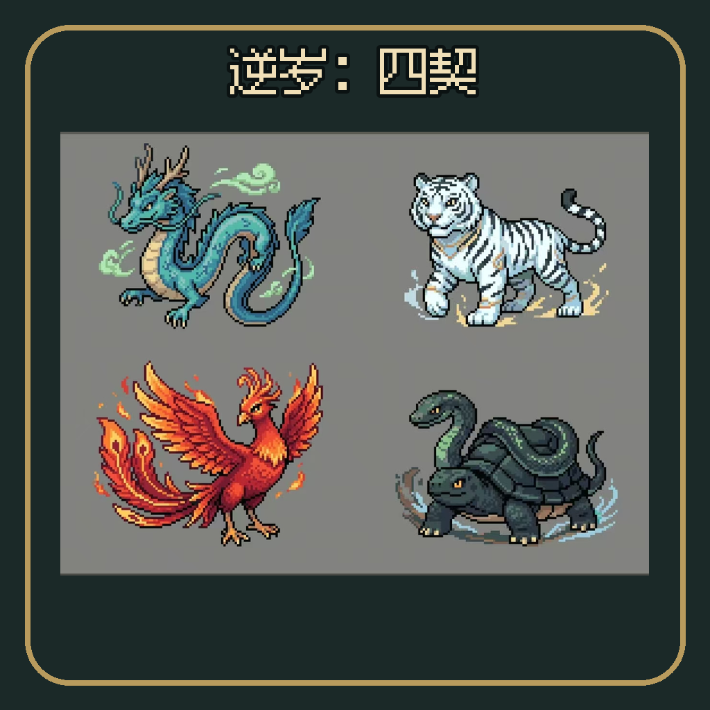

<p align="center">
  
</p>

# 逆岁：四契

**一部围绕白虎、朱雀、玄武、青龙展开的中国神话 2D 横版动作游戏，使用 Godot 4.7 制作。**

二十年前的“断岁夜”之后，冬天不再离开。拾契人砚奉岁庭之命，逐一挑战
白虎、朱雀、玄武、青龙，收回四张神兽面具，并追查四象岁契被谁篡改。

> 项目仍在制作中。现有四幕战役可从头玩到结局，剧情使用简体中文；四象角色、
> 面具、剧情与部分手感系统正在按立项报告逐步替换原有内容。

## Highlights

- 四幕四象战役、断岁夜回忆、剧情过场、失败重试与完整结局。
- 版本化自动存档、标题页“继续旅程”，以及幕开场和 Boss 门前的自动检查点。
- Esc 暂停菜单，支持继续、检查点重试、设置、返回标题与退出；设置包含主音量和全屏显示。
- 通用 Shift 闪身：沿输入或朝向以 940 速度冲刺 0.15 秒，播放独立 8 帧动画，仅提供位移并留下残影，冷却 0.3 秒。
- 剑、雷与护盾基础战斗，以及改变战斗选择的白虎、朱雀、玄武、青龙面具。
- 白虎扩大攻击范围并附带金气特效；朱雀造成 2 秒灼烧；玄武自动格挡并提供
  Q「龙栖」治疗。
- 白虎、朱雀、玄武、青龙四场神兽战与岁庭敌人的攻击预警。
- 四象 Boss 拥有 8 帧攻击动画；玩家模型已替换为拾契人·砚，并接入
  8 帧奔跑、跳跃和攻击动画。
- 面具掉落、跨关卡保留、契息积累与主面具切换。
- A separate checkpoint runner and headless gameplay tests for development.

## Requirements

- [Godot Engine](https://godotengine.org/) 4.7 or newer

## Getting Started

1. Open Godot's Project Manager.
2. Import the repository's `project.godot`.
3. Open the project and press <kbd>F5</kbd> to run it.

If the `godot` executable is available in your `PATH`, you can also launch the
game from the repository root:

```sh
godot --path .
```

## Controls

| Action | Input |
| --- | --- |
| Move left | <kbd>A</kbd> or <kbd>Left Arrow</kbd> |
| Move right | <kbd>D</kbd> or <kbd>Right Arrow</kbd> |
| Jump | <kbd>Space</kbd>, <kbd>W</kbd>, or <kbd>Up Arrow</kbd> |
| Attack | <kbd>Enter</kbd> or left mouse button |
| Use mask | <kbd>Q</kbd> |
| Switch mask | <kbd>E</kbd> |
| Dodge | <kbd>Shift</kbd> |
| Pause / Back | <kbd>Esc</kbd> |
| Advance story | Any new key or mouse-button press |

## Development

### Debug Runner

Launch `debug/debug_runner.tscn` to start a development session with increased
player health and reduced enemy health:

```sh
godot --path . debug/debug_runner.tscn
```

Use <kbd>Ctrl</kbd> + <kbd>1</kbd> through <kbd>8</kbd> to jump to each
campaign act, either at its opening story or directly at gameplay.

### Tests

Headless gameplay tests live in `tests/`. Each standalone test can be run
directly with Godot; for example:

```sh
godot --headless --path . --script tests/smoke_main.gd
```

Run Godot tests sequentially, as required by the repository's test convention.

## Project Structure

| Path | Purpose |
| --- | --- |
| `main.tscn`, `main.gd` | Main scene and campaign orchestration |
| `levels/` | Campaign levels, story data, and level-specific behavior |
| `player/` | 玩家变体、移动、战斗、动画与四象面具控制器 |
| `enemies/` | Standard enemies, bosses, warnings, and enemy skills |
| `combat/`, `weapons/` | Shared damage model and player weapons |
| `objects/` | Interactive world props |
| `ui/` | Title, HUD, story, result, and ending interfaces |
| `assets/` | Art, animation frames, fonts, music, and sound effects |
| `debug/` | Development-only checkpoint runner |
| `tests/` | Headless gameplay and campaign contract tests |
| `tools/` | Maintenance scripts for icon extraction and asset preparation |
| `CONTEXT.md` | Canonical campaign terminology and behavior |

## License

This project is licensed under the [MIT License](LICENSE).
