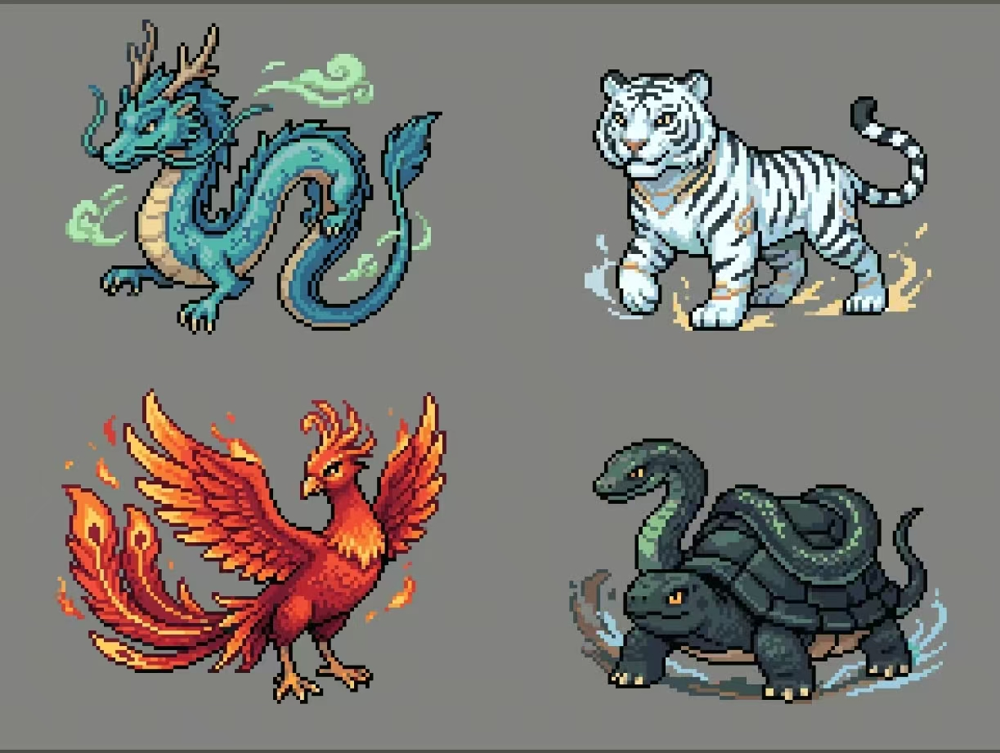

# 《逆岁：四契》立项报告 / 游戏设计文档

> 文档版本：v1.6  
> 日期：2026-10-24  
> 状态：四象主方案，可用于原型制作；角色名、最终标题与部分数值仍需试玩确认  
> 项目基线：Godot 4.7，2D 横版剧情动作游戏，现有四幕 CampaignLevel 战役流程  
> 工作名：《逆岁：四契》

---

## 1. 项目摘要

### 1.1 一句话概念

一名替亡者送信、替活人收愿的“拾契人”，在四季停止流转的神话古国中依次挑战白虎、朱雀、玄武、青龙四方神兽，取得四张神兽面具，并在最终对决后决定：继续维护以少数人牺牲换来的旧契约，还是让世界重新承担时间流动的代价。

### 1.2 产品定义

| 项目 | 定义 |
|---|---|
| 类型 | 2D 横版动作、Boss 战、线性剧情 |
| 核心卖点 | 读招式剑雷盾战斗 + 击败 Boss 获得改变战斗方式的面具 |
| 视觉方向 | 原创中国神话民俗像素风，强调傩面、符箓、青铜、漆木与风雪留白 |
| 叙事方向 | “停岁”灾厄与四份岁契；英雄不是杀邪神，而是判断旧秩序是否值得继续 |
| 单周目时长 | 4–6 小时 |
| 流程结构 | 标题页 → 序章 → 四幕 → 结局页 → DEMO 通关提示 |
| 目标平台 | 先以桌面端 60 FPS 为准，其他平台待确认 |
| 目标玩家 | 喜欢横版动作、Boss 学习、短篇线性叙事与能力成长的玩家 |
| 当前定位 | 现有完整战役的内容与表现重制版，不推翻代码主干 |

### 1.3 设计支柱

1. **读招重于堆数值**：敌人的动作、预警、碰撞与结果必须一致；失败应能归因于判断。
2. **面具改变选择，而非只加属性**：每张面具提供一种新的解题方式，同时保留剑、雷、盾的基础可用性。
3. **神话服务于人物**：文化元素必须落在地名、仪式、敌人行为与人物选择上，不做神名百科或符号拼贴。
4. **胜利必须付出理解**：每个 Boss 都有保护他人的理由；玩家击败他们后获得的力量，也是他们未完成誓愿的一部分。
5. **保留现有可玩骨架**：四幕战役、JSON 剧情、胜败重试、Debug Runner 与无头测试继续作为生产基线。

### 1.4 非目标

- 不改成开放世界、随机地牢、Roguelite 或刷装备游戏。
- 四象是本作核心角色；除白虎、朱雀、玄武、青龙外，不堆叠其他现成神祇的完整履历。
- 不增加必须依赖某张面具才能通过的谜题或 Boss。
- 不在本轮引入多人、复杂技能树、武器掉落或装备稀有度。
- 不把“中国神话”简化为红金配色、龙纹、祥云和神仙称谓的替换。

---

## 2. 现有项目基线与重制原则

### 2.1 可直接保留的部分

| 现有结构 | 处理方式 |
|---|---|
| `main.gd` 的标题、序章、四幕、胜败与结局编排 | 保留，只接入面具进度和新的剧情节点 |
| `CampaignLevel` 关卡契约 | 保留，新增面具解锁与检查点状态的窄接口 |
| `level_base.gd` 的剧情、HUD、音乐、镜头与胜利剧情 | 保留并扩展 |
| 10 份 JSON 剧情 | 保留格式兼容，重写内容，按需增加可选字段 |
| `DamageAndHealth` 生命与死亡结算 | 保留；面具逻辑不写入底层生命模块 |
| 四个 Boss 的场景职责 | 保留重击、冲锋雷击、盾雷震、觉醒追击与黑水周期等机制骨架，并映射为白虎、朱雀、玄武、青龙 |
| 失败重试、Debug Runner、无头测试 | 保留，并扩展面具与剧情合同测试 |

### 2.2 需要替换的部分

- 全部世界观、角色身份、地名、剧情文本和 UI 文案。
- 玩家、四个 Boss、普通敌人、NPC、场景和 UI 的美术表现。
- 现有音乐与音效主题；保留音频播放架构。
- 玩家能力从“随关卡获得雷与盾”扩展为“雷与盾仍在，面具负责改变组合策略”。
- 原“寒冠王座”叙事改为“岁庭、四象岁契与停岁”的神话民俗设定。

### 2.3 核心约束

- 四幕战役结构与现有剧情阶段不能减少。
- 玩家必须能用剑、雷、盾击败每个 Boss；面具是增益与风格选择，不是硬性钥匙。
- Boss 面具必须真正改变攻击、防御或资源选择。
- 四个 Boss 固定为白虎、朱雀、玄武、青龙；四张面具与四兽一一对应。
- 四兽造型以用户提供的像素图为主要美术参考，保留各自动物剪影与元素色。
- 2D 角色继续使用帧动画，不改为 3D 模型。
- 新角色保持现有动作锚点和碰撞尺寸，避免重做整个物理场景。

---

## 3. 世界观

### 3.1 原创规则

世界由“岁令”维持四季、潮汐、作物、归途与亡魂的正常流转。先民无法独自承受天灾，于是与东方青龙、西方白虎、南方朱雀、北方玄武订立“四象岁契”：四兽分别看守木、金、火、水四枚契印，共同维持岁序。

四象岁契确实保护过世界，但它要求神兽永远留在自己的方位，也允许岁庭在必要时从契印中抽取“岁髓”来维持秩序。长期抽取使四季逐渐失衡，形成“停岁”：冬天不再结束，河流停在半途，亡魂找不到归路，活人也开始遗忘节令。

玩家获取面具后，战斗资源称为“契息”。契息不是法力，而是神兽面具对玩家行动的回应：攻击、格挡与理解敌人招式都会产生契息。玩家越主动、越准确地参与战斗，越能借用四象力量。

### 3.2 关键术语

| 术语 | 含义 |
|---|---|
| 停岁 | 四季停止流转的灾厄，表现为永冬、凝河与亡魂迷途 |
| 岁契 | 先民与四象神兽订立的四份护世契约 |
| 岁髓 | 维持旧岁契所需的生命与记忆精华 |
| 岁庭 | 负责记录、执行和维护岁契的世俗机构 |
| 拾契人 | 为亡者送信、为面具寻找继承者的行者 |
| 契息 | 玩家通过有效剑击与精准格挡积累的面具资源 |
| 逆岁 | 借取被封存的时间、强行改变岁序的行为 |
| 四象 | 青龙、白虎、朱雀、玄武四位岁契守护神兽 |
| 四象面具 | 击败四象后取得、分别承载其元素与誓愿的神兽面具 |

### 3.3 核心主题

**旧秩序曾经救人，不代表它可以永远以牺牲维持。**

四位 Boss 都不是“邪神”，而是被旧契与岁庭抽取逼到玩家对立面的四象：

- 白虎守住秋金之契，防止山崩与兽潮吞没最后的迁徙路。
- 朱雀守住夏火之契，让被冻结的太阳与火种仍能回到人间。
- 玄武守住冬水之契，把洪水困在自己的甲壳与河道中。
- 青龙守住春木之契，试图让世界停留在灾难发生前一刻。

玩家击败他们后获得面具，也获得他们的记忆。最终不是“消灭神话”，而是决定谁来承担神话继续存在或结束的后果。

---

## 4. 人物设计

| 角色 | 身份 | 叙事职能 | 现有角色映射 |
|---|---|---|---|
| 拾契人·砚 | 玩家角色，替亡者送信的流浪剑士 | 从执行岁庭命令，转为亲自判断岁契是否应继续 | 艾拉 |
| 青龙 | 东方春木之神，四象岁契的执首者 | 最终 Boss；曾救过年幼的砚，却拒绝结束停岁 | 瓦尔德玛 |
| 幼年砚 | 二十年前断岁夜中的孩子 | 回忆关解释青龙为何选中她成为拾契人 | 小艾拉 |

### 4.1 玩家身份说明

砚不是神祇转世，也不是任何神兽的化身。断岁夜中，青龙把一粒未发芽的春种留在她体内，使她能够听见残存于信物中的遗愿。她替亡者送信的经历让这份能力真正成熟，因此“戴面具”是承接誓愿，而不是单纯拾取能力。

### 4.2 视觉身份

玩家使用短直剑、深靛色行旅长衣、皮革护肩、赭红腰带与四枚悬挂面具。她没有成套重甲，轮廓比原骑士更轻，便于表现横版移动和快速换势。

---

## 5. 四幕剧情

### 5.1 全局结构

| 阶段 | 场景 | 核心事件 | 奖励 / 转折 |
|---|---|---|---|
| 标题页 | 永冬山路 | 开始、退出 | 建立“有人在雪中送信”的意象 |
| 序章页 | 断岁夜插画 | 二十年前，青龙的春种救下砚 | 埋下青龙与旧灾的关系 |
| 操作指南 | 岁庭驿道 | 教学内容 | 开始第一幕 |
| 第一幕：金契 | 虎踞霜关 | 击败白虎 | 获得白虎面具，得知四象在保护百姓 |
| 回忆关 | 二十年前断岁夜 | 幼年砚看见青龙降下春种 | 解释玩家听见面具誓愿的能力 |
| 第二幕：火契 | 赤羽烬原 | 砚独自调查冻结的火种；击败朱雀 | 获得朱雀面具，发现四象身上有岁庭符印 |
| 第三幕：水契 | 玄渊冰河 | 砚从冰层刻印查明真相；击败玄武 | 获得玄武面具，明确岁庭在抽取岁髓 |
| 第四幕：木契 | 青龙岁庭 | 砚独自读取逆岁印；击败青龙 | 获得青龙面具，决定终止旧岁契 |
| 归岁 | 停岁裂隙 | 使用青龙面具查看四象最后的愿望 | 让四季重新流动，保留记忆与代价 |
| 结局页 | 初春山路 | 砚继续送信与收愿 | 完成主题闭环 |

### 5.2 序章页

以静态叙事页呈现：

> 二十年前，岁序第一次断裂。  
> 那一夜没有春天。  
> 一条青色龙影掠过冻住的灰烬，  
> 把一粒春种留在孩子掌心。

这里不出现西式王权意象，只通过“四象”“岁庭”与“岁契”建立神话规则和身份谜团。

### 5.3 第一幕：山契

**地点：** 虎踞霜关。  
**目标：** 岁庭要求砚前往霜关，确认山契为何失效。  
**旅途事件：** 玩家看到被冻在路边的迁徙者、停摆的风车和守着粮箱的石像。  
**Boss：** 白虎。  
**胜利：** 白虎从破碎的金色契印中留下白虎面具，记录它曾挡住山崩与兽潮的誓言。

开场独白建议：

> 停岁之后，太阳每天只多留一盏茶。  
> 人们把最后一袋种子挂在门上，像等一封永远不来的信。  
> 岁庭说，西方的白虎疯了。  
> 我带着岁庭印信上路，也带着一封写给死人的信。

**转折：** 白虎不是袭击村庄的怪物，而是在阻止山体继续崩塌；真正崩溃的是岁庭抽取岁髓的符钉。

### 5.4 回忆关：断岁夜

保留现有“第一幕开场后插入 Level 00，再回到第一幕”的结构。内容改为：

- 幼年砚在冻住的灾场中寻找家人。
- 一条青龙虚影穿过停住的雪，覆在幼年砚身前挡住逆岁印。
- 龙影没有留下姓名，只把一粒青色春种送入她掌心。
- 拾信人告诉她：“剑不是为了替人决定生死，而是让来不及跑的人还有一步可走。”
- 这句话在第四幕成为砚拒绝青龙继续封住春天的依据。

### 5.5 第二幕：雷契

**地点：** 赤羽烬原。  
**目标：** 夏季与火种被锁在云层下，庄稼无法成熟。  
**调查线索：** 砚独自沿着朱雀羽痕前进，发现火痕有意避开村庄，只烧灼被岁庭抽取过岁髓的枯田。  
**Boss：** 朱雀。  
**胜利：** 朱雀留下朱雀面具，面具显示出与官驿封印相同的岁庭符印。

**转折：** 四象不是灾厄源头；岁庭一直在用符印抽取它们的力量。

### 5.6 第三幕：水契

**地点：** 玄渊冰河与冻结的河神祭场。  
**目标：** 水系契印失控，凝河开始淹没两岸。  
**Boss：** 玄武，拥有壳甲盾、玄水雷雨与潮裂震击。  
**关键事件：** 砚在冰层下发现多道逆岁印，确认岁庭正在借玄武的身体维持停岁。  
**真相揭示：** 刻印记录显示四象并非想制造停岁，而是被旧契要求把世界固定在灾难发生前的时刻。  
**胜利：** 玄武留下玄武面具。玩家第一次可以用面具反弹 Boss 的投射物。

死亡演出沿用现有“玩家跑到指定位置、镜头跟随、角色无缝替换”的架构，改为：

- 砚独自走过断桥，在玄武倒下的位置停下。
- 砚读出冰层中的岁庭刻印，确认四象一直在替人间承担代价。
- 玩家被替换为死亡画面中的静默剪影，不用瞬移或突兀消失。

### 5.7 第四幕：岁契

**地点：** 岁庭中枢与停岁裂隙。  
**Boss：** 青龙。  
**前置信息：** 砚从岁庭留存的契册与地面逆岁印中确认，岁庭借四象岁契抽取岁髓。

青龙的动机：

- 它亲历过断岁夜，知道一次灾变可以毁灭多少家庭。
- 它试图把四季固定在“灾变尚未发生”的最后一刻。
- 它认为自由会让世界再次受伤，因此愿意成为永远维持秩序的神兽。

砚的反驳：

> 你把春天留在门外，说这样冬天就不会伤人。  
> 可不被允许抵达的春天，和从未到来没有分别。

最终战后：

- 青龙的逆岁甲碎裂，恢复成青色龙影；它终于承认保护不等于替众生决定时间。
- 砚获得青龙面具。
- 她不把第四契归还岁庭，而是进入归岁段，使用青龙面具查看四象留下的愿望。

### 5.8 归岁与结局

**归岁段：** 2–3 分钟的可操作尾声，玩家按交互键使用青龙面具，让四象的记忆进入停岁裂隙。这里不战斗，只通过移动与观察完成最后选择。

**最终选择采用单一主线结果：**

- 砚没有续写旧岁契，也没有让全部岁令瞬间崩解。
- 她用四张神兽面具把“守”从永久监禁改为可被继承的责任。
- 四季重新流动，但冬天仍会伤人，世界开始承担未知与自由。
- 岁庭被拆解，砚成为第一位不替任何机构收契的拾契人。

结局页文字：

> 春天没有在一夜之间回来。  
> 河先醒了一条缝，稻田迟了十三天，  
> 第一个不再被岁契选中的孩子，  
> 在泥里跑了一整圈。  
> 砚把四张神兽面具收进包里，继续替人送信。

---

## 6. 四象 Boss 与神兽面具

### 6.1 Boss 机制映射

| 新 Boss | 原 Boss 职责 | 保留机制 | 神话与关卡解释 |
|---|---|---|---|
| 白虎 | 熊王 | 重体接触、地震、近身压迫、死亡演出 | 西金秋神，守住霜关与迁徙路 |
| 朱雀 | 狼王 | 前冲、雷火落点、距离检测、技能预警 | 南火夏神，守着被冻结的太阳 |
| 玄武 | 鹿王 | 壳甲、雷雨、地震并发、终局镜头 | 北水冬神，以身困住失控洪水 |
| 青龙 | 瓦尔德玛 | 觉醒、追击、黑水持续伤害、阶段转换 | 东木春神，执掌四象岁契 |

四幕按照“契约强度与叙事推进”排列，不表示地理方位巡游。四象的传统方位仍保留在世界观和场景设计中。

### 6.2 白虎

**参考造型：** 白底黑纹的猛虎，青色眼瞳、金色刀纹、雪地与冲击波粒子。主体必须一眼读成虎，不能做成石像或麒麟。

**战斗阶段：**

1. 低姿态巡逻，以身体阻断道路。
2. 预警后扑击，扑空会露出两秒背身弱点。
3. 重击落地释放横向金气冲击波。
4. 低血量后增加一次短距离二次扑击。

**弱点：** 扑击后的转身窗口；精准格挡冲击波可大幅削减姿态。

**对应面具：白虎面具**

- 被动：普通剑击附带白金色双层斩弧特效；普通攻击范围为 1.5 倍，白虎面具在此基础上再乘 2.0，最终为 3 倍。斩弧与实际武器碰撞距离同步，伤害为普通的 2 倍。
- 被动：攻击碰撞范围提升 35%。
- 战斗变化：强化基础剑击的命中覆盖，让玩家更容易在移动战中维持压制。

### 6.3 朱雀

**参考造型：** 红橙羽翼、金色冠羽与尾焰的凤凰形神鸟；保留鸟类腿爪、长尾和高亮火羽，不使用普通鹤形。

**战斗阶段：**

1. 从空中俯冲穿过玩家位置，落点留下火羽。
2. 朝玩家发射一枚 2.16 倍体积、速度 570 的红色火球，复用雷球的飞行表现；命中造成单次伤害。
3. 低血量后俯冲与火雷交替，形成短时间攻防转换。
4. 「焚空火羽」：不绑定二阶段，战斗开始后按冷却升空并向玩家发射三枚扇形火羽，落地后短暂恢复地面战斗。

**弱点：** 俯冲结束后的羽毛回收阶段；火雷落点预警清晰但间隔更短。

**对应面具：朱雀面具**

- 被动：普通剑击附带朱雀火焰斩击特效。
- 被动「灼烧」：命中的敌人进入 2 秒灼烧，每 0.5 秒受到 1 点伤害，共结算 4 次。
- 灼烧不受普通受击免疫影响，但不会额外造成硬直或击退。
- 战斗变化：奖励持续进攻，适合用短连续命中延长伤害收益。

### 6.4 玄武

**参考造型：** 墨绿色巨龟与盘绕长蛇共体，龟甲厚重、蛇首高抬、足下环绕青蓝水纹；不是单纯的龟或鹿。

**战斗阶段：**

1. 「玄雷落」：独立技能，持续 6 秒，每 0.6 秒在可视地图三段区域各随机落下一束雷电，三束互不相邻；雷击播放结束后再进入 10 秒冷却。
2. 「地裂震击」：独立技能，拥有自己的冷却和完整预警。雷击进行期间即使地震已经就绪也必须延后；雷击结束后，仅在玩家进入攻击检测范围时重新显示 0.7 秒警示，警示完成后再释放地震。
3. 雷击与地震不会并发；两者谁先释放由各自冷却、当前状态和玩家位置决定，不再组成固定二连。
4. 甲壳展开护盾，抵挡一次伤害并启动破碎窗口。
5. 壳甲破碎后短暂降低防御，但近身接触伤害提高。

**弱点：** 壳甲破碎窗口；潮裂后的静止观察期。

**对应面具：玄武面具**

- 被动：自动格挡下一次原本会生效的攻击，冷却 10 秒。
- 主动「龙栖」：按 Q 恢复 1 点生命，冷却 15 秒。
- 自动格挡不会消耗生命、不会触发受击硬直，也不消耗普通受击免疫。
- 战斗变化：提高容错并增加有限续航，适合守势与长线 Boss 战。

### 6.5 青龙

**参考造型：** 青绿色长龙，鹿角、蛇身、四爪、浅色腹甲、尾鳍与云雾符纹；身体必须能盘绕场景，不采用西式双翼龙。

**战斗阶段：**

1. **云行：** 人形大小的鳞片幻身在地面追击，使用龙息与快速转向。
2. **逆岁觉醒：** 展开完整龙躯，场景变暗，岁契环出现在背景。
3. **岁刃：** 沿玩家方向穿行，留下短暂时间裂隙。
4. **逆岁墨潮：** 每 16 秒释放覆盖地面的持续性黑水潮。
5. **紫雷腾云：** 青龙一阶段按 12 秒冷却释放一次双雷球紫雷龙息；紫色爆发阶段严格按两次剑光、一次墨潮、两次剑光、一次紫雷龙息的顺序循环，雷息每轮 4 枚，间隔 0.8 秒连续两轮后落地。
6. **逆鳞扑杀：** 每累计承受 3 次玩家有效攻击触发一次；青龙先以 0.55 秒预警腾空，再锁定玩家当前位置俯冲扑击。扑击造成 1 点伤害，命中后返回原站位并恢复地面攻击循环，过程不可被受击打断。
7. **终局：** 生命归零后完整蜷缩、碎裂为青色光点，然后再显示青龙面具。

**弱点：** 岁刃后的转身停顿；墨潮结束后露出的颈部契印。

**对应面具：青龙面具**

- 主动「照岁龙息」：消耗 40 契息，标亮 Boss 弱点 3 秒，期间命中增加 30% 姿态伤害。
- 被动「回春」：雷击命中弱点目标返还 8 契息，每次照岁期间最多触发两次。
- 战斗后：归岁段使用青龙面具查看四象遗愿；NG+ 可直接装备。

### 6.6 四象面具总表

| 面具 | 来源 | 主动能力 | 被动能力 | 主要战斗选择 |
|---|---|---|---|---|
| 白虎面具 | 白虎 | 无 | 攻击附带同步命中距离的白金斩弧，在普通攻击 1.5 倍范围上再乘 2.0，最终范围 ×3，伤害 ×2 | 扩大压制范围并强化单次命中 |
| 朱雀面具 | 朱雀 | 无 | 攻击附带火焰特效，命中后灼烧 2 秒并持续闪红 | 连续命中延长持续伤害 |
| 玄武面具 | 玄武 | Q「龙栖」恢复 1 点生命，冷却 15 秒 | 自动格挡下一次攻击，冷却 10 秒 | 容错与有限续航 |
| 青龙面具 | 青龙 | 标记弱点 | 弱点雷击返还契息 | 弱点窗口与资源回收 |

### 6.7 面具装备规则

- 每次只能装备一张主面具和一张不同来源的辅面具。
- 主面具提供主动技与被动；辅面具只提供被动。
- 总被动最多两条，不允许四张面具叠加属性。
- 主动技能冷却按面具独立保存；切换面具不会刷新冷却，切走期间仍持续倒计时。
- 面具在检查点或安全配置点更换；进入 Boss 战后锁定。
- 每个神兽面具只在第一次确认胜利时发放一次，重试和重复播放胜利剧情不会重复发放。
- 所有 Boss 均可仅用基础剑、雷、盾击败。

---

## 7. 核心战斗与成长系统

### 7.1 每幕循环

进入新区域 → 读取环境与敌人线索 → 短平台段 → 普通遭遇 → 检查点与面具配置 → Boss 战 → 面具解锁与胜利剧情 → 进入下一幕。

### 7.2 单次交锋循环

观察预警 → 选择举盾、精准格挡、拉开距离或抢攻 → 获得契息或制造姿态破绽 → 选择雷击或面具主动技 → 在窗口追加剑击 → 调整站位。

### 7.3 基础资源

| 资源 | 规则 |
|---|---|
| 生命 | 以现有 5 心生命为基础，不做无意义的全游戏 HP 重写 |
| 契息 | 0–100；有效剑击 +8，第三击额外 +4，精准格挡 +18 |
| 检查点初始化 | 恢复生命；契息至少恢复至 60 |
| 面具主动技 | 消耗 35–40 契息，只能通过剑击与格挡积累 |
| 拾取限制 | 契息不自动回复，避免龟缩刷资源 |

### 7.4 攻击与防御

- 剑为三段轻连击，伤害递增，恢复也递增。
- 通用闪身由 Shift 触发，播放独立 8 帧前倾冲刺动画，沿当前移动或朝向以 940 速度冲刺 0.15 秒；仅提供位移，不提供无敌，受击会中断，冷却 0.3 秒。
- 攻击继续使用共享冷却和“最多一次待执行攻击”的既有概念。
- 精准格挡窗口为按下盾后的前 8 帧。
- 精准格挡不消耗生命，造成短硬直并增加契息。
- 失败格挡仍可减少部分伤害，但不产生资源；不可格挡招式用独立警示形状标识。
- 雷击消耗契息，首轮冷却 0.4 秒，用于远程补伤、打断可打断动作和触发面具状态。

### 7.5 手感参数首轮基线

以下数值以 60 FPS 为目标，并应以现有碰撞尺寸和动画长度实测修正。

| 类别 | 参数 | 首轮目标 |
|---|---|---:|
| 移动 | 地面最高速度 | 300 px/s，保持现有节奏，不直接砍半 |
| 移动 | 地面加速度 / 制动 | 2,200 / 2,800 px/s² |
| 跳跃 | 跳跃初速度 | -550 px/s |
| 跳跃 | 上升 / 下落重力 | 1,050 / 1,450 px/s² |
| 跳跃 | 土狼时间 | 0.10 秒 |
| 跳跃 | 跳跃缓冲 | 0.12 秒 |
| 跳跃 | 松键减速 | 上升速度 × 0.45 |
| 攻击 | 预输入 | 动作结束前 0.12 秒缓存一次攻击 |
| 攻击 | 命中停顿 | 普通 3–4 帧；重击 5–7 帧；破防 7–9 帧 |
| 攻击 | 取消 | 命中后 3 帧起允许取消到盾、雷或面具技 |
| 防御 | 精准格挡 | 0.13 秒 |
| 防御 | 盾破窗口 | 0.45 秒，期间拒绝重复伤害 |
| 镜头 | 水平前瞻 | 60 px |
| 镜头 | 平滑 | 6–8 |
| 震屏 | 普通命中 | 1–2 px / 0.06 秒 |
| 震屏 | 精准格挡 | 2–3 px / 0.08 秒 |
| 震屏 | Boss 破防 | 3–4 px / 0.12 秒 |
| Boss | 基础预警 | 至少 0.65 秒 |
| Boss | 高压二段预警 | 不短于 0.45 秒，并须有安全示范 |

### 7.6 反馈优先级

1. 精准格挡与 Boss 弱点命中：最亮、最清晰、最强音色。
2. 普通剑击命中：短停顿、火花、击中音。
3. 玩家受击：方向性击退、短闪、专用受击音。
4. 背景粒子与装饰：最低优先级，不得遮挡预警、角色轮廓和碰撞边界。

### 7.7 难度与可访问性

- 默认难度保持“可学习但需要判断”。
- 精准格挡必须是有回报的选项，不能成为唯一过关方式。
- 震屏提供关闭/降低选项。
- 不可格挡攻击不能只靠颜色区分。
- 暂停界面显示输入提示与面具效果说明。

---

## 8. 美术与资源规格

### 8.1 总体风格

**关键词：** 古拙、克制、像素、寒白、黛青、赭红、青铜、漆木、傩面、符纸、风雪留白。

四象造型以用户提供的四神兽像素图为视觉基准：



参考图用于确定四象的动物剪影、主色、元素粒子和像素轮廓；正式游戏资源必须重新制作透明背景、脚底锚点、朝向与动作帧，不能直接把参考图当作精灵图拆分使用。

避免：

- 西式城堡、王冠、教堂式彩窗。
- 每个角色都穿龙袍或堆满祥云。
- 用单一红色代表所有危险。
- 现代仙侠的高饱和光效和过度粒子。

### 8.2 色彩层级

| 层级 | 主色 | 用途 |
|---|---|---|
| 环境 | 寒白、灰青、墨蓝 | 停岁、冻土、远景 |
| 人间 | 赭红、木褐、暖黄 | 村庄、灯火、符纸 |
| 神性 | 青铜绿、暗金 | 岁庭、契印、面具 |
| 危险 | 朱砂红、紫黑 | 不可格挡、逆岁力量 |

四象专属识别色：

| 神兽 | 主色 | 辅助色 | 元素表现 |
|---|---|---|---|
| 白虎 | 雪白 | 黑、青、金 | 金气、雪尘、扑击残影 |
| 朱雀 | 朱红 | 橙黄、金 | 火羽、余烬、热浪 |
| 玄武 | 墨绿 | 青蓝、石灰 | 水纹、甲壳反光、黑潮 |
| 青龙 | 青绿 | 浅米、碧蓝 | 云雾、雷纹、春季嫩光 |

### 8.3 角色与 Boss 技术规格

| 项目 | 规格 |
|---|---|
| 单帧画布 | 256 × 256，透明背景 PNG |
| 锚点 | 脚底中心，与现有 Sprite2D 对齐 |
| 朝向 | 制作 east 源帧，west 使用水平翻转 |
| 主动画帧数 | idle 4–6、run 7–9、jump 7–9、attack 8–9、hurt 6–7、dead 8–9 |
| 像素采样 | 最近邻，不使用平滑缩放 |
| 轮廓 | 角色主体 2 px，内部细节 1 px |
| 色数 | 单个角色建议 12–20 色，保持剪影可读 |
| 预警 | 独立帧/特效，不能只改角色颜色 |

### 8.4 玩家模型改造

保留现有玩家动作状态和碰撞框，只替换视觉层时需要覆盖：

- idle
- running
- jump
- attack 三段
- hurt
- dead
- on_knees
- 面具佩戴与摘除
- 四种主动技起手
- 精准格挡与盾破

### 8.5 四个 Boss 资产

| Boss | 必需动画 |
|---|---|
| 白虎 | idle、run、预警、扑击、金气冲击、hurt、dead |
| 朱雀 | idle、飞行动作、预警、俯冲、火雷、hurt、dead |
| 玄武 | idle、run、预警、水弹、雷雨、潮裂、盾破碎、hurt、dead |
| 青龙 | 云行、觉醒、龙躯 idle/run、岁刃、墨潮、hurt、dead |

### 8.6 场景资产

每个关卡至少三张视差层：

- 远景：天空、山体、月轮、年轮或岁庭轮廓。
- 中景：可玩区域的可读背景、道路、门楼、祭台。
- 近景：雪枝、芦苇、幡布、石灯、前景遮挡。

建议关卡：

1. 虎踞霜关：冻土、迁徙路、金纹兽骨与白虎爪痕。
2. 赤羽烬原：冻结的火田、云井、朱雀羽纹与残阳。
3. 玄渊冰河：凝河、龟甲祭台、玄水雷云。
4. 青龙岁庭：盘龙柱、停摆日晷、四契环廊与黑水裂隙。
5. 归岁山路：初融雪、嫩芽、送信路。

### 8.7 UI 与面具表现

- HUD 使用符纸与木牌感，不做繁复仙侠边框。
- 剧情对白中玩家立绘固定左侧并面朝右，其他说话者位于右侧。
- Controls 页面使用中文标题、中文分区与中文操作说明，按键字母保持原样。
- 面具图标必须有独立剪影，缩小到 32 px 仍能区分。
- 面具解锁演出：对应神兽面具从碎裂的契印中浮起，短暂展示四象记忆，再落到玩家腰间。
- 主面具/辅面具配置界面显示两个可见槽位与两条被动说明。
- 契息条使用暗金细线，满值时变为暖黄，不使用整屏泛光。
- 最终页面显示“恭喜通关DEMO内容，完整版敬请期待”，不再显示制作人信息。

---

## 9. 音频方向

| 类型 | 方向 |
|---|---|
| 主题音乐 | 古琴、笛、箫、埙、鼓、钟磬与弦乐的现代混合 |
| 战斗音乐 | 保留民乐音色，但以节奏组推动 Boss 阶段变化 |
| 剑击 | 木、金属、雪地三种材质音色 |
| 精准格挡 | 独立的青铜钟鸣和短促木击 |
| 面具解锁 | 低音鼓 + 引磬 + 人声气音，不使用长段神谕式合唱 |
| Boss 预警 | 每种攻击拥有独立起势音，不能只靠视觉 |
| 环境 | 风声、冰裂、河流、乌鸦、远处钟声 |

四象战斗主题：

- 白虎：鼓点、低音弦、金属刮擦与短促虎啸。
- 朱雀：笛声、战鼓、火焰噼啪与高音铃。
- 玄武：埙、低音鼓、水声与厚重甲壳撞击。
- 青龙：古琴滑音、钟磬、雷声与螺旋式弦乐。

玩家角色不配置全程配音；关键 Boss 与归岁段可采用短句配音或文字音效，具体待预算确认。

---

## 10. Godot 技术方案

### 10.1 模块职责

| 模块 | 职责 |
|---|---|
| `main.gd` | 标题、序章、四幕、结局和顶层场景切换 |
| `CampaignLevel` | 当前关卡胜败、剧情阶段、检查点、音乐和面具解锁出口 |
| `LevelBase` | 通用剧情、HUD、镜头、胜利流程 |
| `Player` | 移动、攻击、盾、雷、受击和面具技能触发 |
| `MaskController` | 主面具/辅面具装备、契息、被动触发和冷却 |
| `CampaignProgress` | 已解锁面具、Boss 胜利、剧情旗标和配置 |
| `CampaignSave` | 版本化自动存档、幕／Boss 检查点、Continue 数据校验与备份回退 |
| `GameSettings` | 主音量、全屏显示及独立设置文件 |
| `PauseMenu` | Esc 暂停、检查点重试、设置、返回标题与退出 |
| `DamageAndHealth` | 只负责生命、伤害接收、死亡和信号 |
| Boss 脚本 | 各自阶段、预警、姿态、破绽和死亡演出 |
| JSON Story | 对白、角色立绘、剧情旗标和演出提示 |

### 10.2 面具数据模型

建议新增 `MaskDefinition` Resource，保存：

```text
id
display_name
unlock_boss_id
active_cost
active_cooldown
active_effect_id
passive_trigger_id
passive_effect_id
effect_params
icon
skill_scene
description
```

建议 `CampaignProgress` 保存：

```text
unlocked_mask_ids: Array[StringName]
defeated_boss_ids: Array[StringName]
primary_mask_id: StringName
secondary_mask_id: StringName
story_flags: Dictionary
```

### 10.3 事件流

1. 玩家完成有效剑击或精准格挡，战斗层发出 `combat_event`。
2. `MaskController` 根据当前主面具/辅面具和事件类型增加契息或触发被动。
3. Boss 死亡第一次被确认，`CampaignLevel` 将 `boss_id` 交给 `CampaignProgress`。
4. `CampaignProgress` 只发放一次对应面具，并更新剧情旗标。
5. 胜利剧情读取旗标，播放对应对白。
6. 下一幕从 `CampaignProgress` 读取已解锁面具和当前装备。
7. `DamageAndHealth` 不读取面具、Boss 阶段或 UI，只继续处理生命与死亡。

### 10.4 场景改动原则

- 保留现有 Player/Boss 场景结构和 CollisionShape2D。
- 先替换 `Sprite2D`、`AnimationPlayer`、`AnimationTree` 资源，再调整轮廓与碰撞。
- 面具主动技作为 Player 子节点或独立技能场景添加，不把四个技能硬编码进主玩家状态机。
- Boss 继续持有自己的技能节点；不要建立通用“万能 Boss 技能系统”。
- 剧情 JSON 保留现有 `left/right/name/content` 字段，新增字段必须可选；显示层不能把显示文本当作逻辑 ID。

### 10.5 数据与存档

当前若没有正式存档系统，先以 `CampaignProgress` 内存对象支持单次完整战役；一旦加入保存，使用稳定 ID 而非中文显示名。重试时不得重复发放面具、重复播放已确认剧情或重复写入剧情旗标。

---

## 11. 关卡改造表

| 现有场景 | 新场景 | 主要玩法教学 | Boss |
|---|---|---|---|
| `level_01` | 虎踞霜关 | 移动、剑、预警、第一张神兽面具 | 白虎 |
| `level_00` | 断岁夜回忆 | 操作教学与关系铺垫，插入第一幕开头后 | 无 |
| `level_02` | 赤羽烬原 | 盾、雷、契息、远程敌人 | 朱雀 |
| `level_03` | 玄渊冰河 | 精准格挡、面具协同、终局演出 | 玄武 |
| `level_04` | 青龙岁庭 | 综合运用、Boss 阶段、归岁段 | 青龙 |

---

## 12. 生产范围

### 12.1 垂直切片 MVP

目标是先证明“中国神话改版 + 面具 + 手感”真的好玩：

- 一名重绘玩家角色。
- 第一幕虎踞霜关。
- 一个普通敌人类型。
- 白虎完整 Boss 战，造型以参考图为基准。
- 白虎面具完整获取、装备与攻击反馈。
- 一段完整 JSON 剧情与面具解锁演出。
- 跳过/播放第一幕二周目体验。
- 基础手感改造：土狼时间、跳跃缓冲、攻击预输入、命中停顿、精准格挡和震屏。
- 至少 6 个新增无头测试。

### 12.2 完整版范围

- 四幕剧情与 10 份 JSON 全部重写。
- 玩家、白虎/朱雀/玄武/青龙、四种普通敌人、NPC、场景和 UI 全部重做。
- 四张神兽面具、主面具/辅面具配置与归岁段。
- 至少 7 首主题音乐与 25–40 个战斗/环境音效。
- 完整 Debug Runner 与新面具测试。
- 原生 Windows 导出与一次完整通关测试。

### 12.3 资源清单

| 资源 | 数量 |
|---|---:|
| 玩家动画 | 10 组，约 80–100 帧 |
| 四象动画 | 4 位神兽 Boss，约 28 组，约 240–300 帧 |
| 普通敌人 | 4 种，约 20 组 |
| NPC/剧情立绘 | 6–8 个角色 |
| 四象面具图标 | 4 个 |
| 面具主动技特效 | 4 套 |
| 关卡背景 | 5 个场景 × 3 层 |
| UI 界面 | 标题、HUD、面具、剧情、胜败、结局 |
| 音乐 | 7 首左右 |
| 音效 | 25–40 个 |

### 12.4 假设排期

按“1 名程序 + 1 名美术 + 兼职叙事/音频”估算：

| 阶段 | 内容 | 预计周期 |
|---|---|---:|
| A. 预制作 | 工程盘点、美术规范、面具原型、纸面战斗 | 1–2 周 |
| B. 垂直切片 | 第一幕、玩家、白虎、白虎面具、手感 | 3–4 周 |
| C. 系统锁定 | 面具控制器、进度、剧情旗标、测试 | 3 周 |
| D. 内容制作 | 三幕、三 Boss、敌人、场景 | 8–12 周 |
| E. 打磨 | 动画、音频、UI、平衡、完整通关 | 4–6 周 |
| 合计 |  | 19–27 周 |

单人同时负责程序和美术时，建议按 9–12 个月评估。上述节奏不含外部平台移植和完整本地化。

---

## 13. 验收标准

### 13.1 功能

- 可从标题页开始，完整走完序章、四幕、死亡重试、胜利剧情、归岁段、结局页与 DEMO 通关提示。
- 白虎、朱雀、玄武、青龙均可在基础剑/雷/盾条件下击败。
- 每个 Boss 面具只发放一次，并能跨关卡保留。
- 面具装备、主动技、被动触发、消耗、冷却和重试重置均正确。
- 重试不重复播放已确认的长剧情，也不重复写入掉落与旗标。

### 13.2 手感

- 跳跃、落地和攻击不出现吞键或明显延迟。
- 土狼时间、跳跃缓冲和攻击预输入在自动化测试中可验证。
- 精准格挡、普通命中、受击和破防的反馈层级可区分。
- Boss 预警、碰撞框和伤害判定帧一致。
- 在目标机器上保持 60 FPS，震屏可关闭。

### 13.3 叙事与美术

- 玩家、四象、场景、UI 不再出现西方王权、教堂或寒冠意象。
- 至少四幕中每一幕都有一个“四象在保护谁”的具体证据。
- 每个面具的来源、名称、外观和技能在海报与 UI 上可对应。
- 四象的造型、主色、元素和动作能对应参考图，同时具备 256×256 游戏帧所需的安全边距。
- 所有最终资产经过原生尺寸检查，透明边缘、脚底锚点和朝向正确。

### 13.4 工程

- `DamageAndHealth` 不承担面具、剧情或 UI 职责。
- `main.gd` 不处理 Boss 招式或面具被动逻辑。
- 至少保留并运行现有 smoke main 与关键战役合同测试。
- 新增面具、Boss 解锁、剧情旗标、手感参数和重试一致性测试。

---

## 14. 主要风险

| 风险 | 影响 | 缓解 |
|---|---|---|
| 神话符号拼贴 | 视觉像换皮，缺乏原创性 | 先锁定“岁契”规则，再设计所有地名、服装和能力 |
| 面具破坏基础战斗 | 玩家只等技能，剑盾失去意义 | 所有面具消耗契息；基础剑盾仍能通关 |
| Boss 只能被指定面具克制 | 强制流派，重试体验差 | 每个 Boss 至少有两套有效组合，不以面具作硬门槛 |
| 重绘全部动画导致排期失控 | 内容和程序互相等待 | 先做第一幕垂直切片，通过后再批量生产 |
| 手感改得过多 | 旧关卡敌人和碰撞失效 | 参数集中配置，先调移动与反馈，再改敌人节奏 |
| 文化表现不均 | 四幕风格割裂 | 先做一张统一美术规范与色板，再分批生产 |
| 四象辨识度不足 | 玩家只看到四只普通动物 | 保留参考图中的专属轮廓、主色、元素粒子和纹样，并在预告/UI 中持续强化 |
| 四象顺序与方位混淆 | 玩家误以为四幕是严格方向巡游 | 明确四幕是旧契强度顺序，方位只用于区域设计和叙事象征 |
| 面具与剧情耦合 | 存档、重试和胜利流程出现重复奖励 | 用稳定 ID 与一次性事务写入 |
| 终局面具获取太晚 | 第四张面具缺少实际用途 | 用归岁段提供可操作能力展示，并在 NG+ 开放常规装备 |

---

## 15. 待确认决策

以下内容不会阻塞垂直切片，但应在正式批量生产前确认：

1. 最终标题是否采用《逆岁：四契》。
2. 玩家是否保持女性主角，或改为玩家自定义身份。
3. 是否保留单一主线结局，或增加“续契 / 逆岁”分支结局。
4. 目标平台是否只做 Windows，或需要 Steam Deck、macOS 等。
5. 配音预算是否支持 Boss 短句和归岁段。
6. 美术采用当前 256×256 帧规格，还是重新统一到 128×128 像素规格。

---

## 16. 下一步

1. 以现有工程为准核对 Player、四个 Boss、剧情 JSON 和测试接口。
2. 制作第一幕垂直切片：虎踞霜关、白虎、白虎面具。
3. 在切片中先实现统一战斗事件和面具控制器，再接朱雀、玄武、青龙面具。
4. 完成玩家与 Boss 的美术规范、动画测试帧和一套可读的 UI。
5. 组织一次 20–30 分钟试玩，重点观察玩家是否看懂预警、是否主动切换剑雷盾、是否理解面具改变了战斗。

---

## 附录：设计来源

本报告基于以下当前项目内容整理：

- `README.md`：现有项目定位、四幕战役与输入操作。
- `CONTEXT.md`：现有战役阶段、Boss 与战斗合同。
- `main.gd`、`levels/campaign_level.gd`、`levels/level_base.gd`：战役编排与关卡生命周期。
- `player/player.gd`、`player/player_04.gd`：移动、攻击、护盾与受击状态。
- `enemies/*.gd`、`enemies/*.tscn`：四个 Boss 的现有机制职责。
- `levels/*.json`：10 份剧情节点与人物关系。
- 用户提供的四象像素参考图：`docs/game-design/assets/four-symbols-reference.jpg`。
- 本项目 Game Designer 设计线程中的概念、顶层设计、架构和核心玩法提案。
